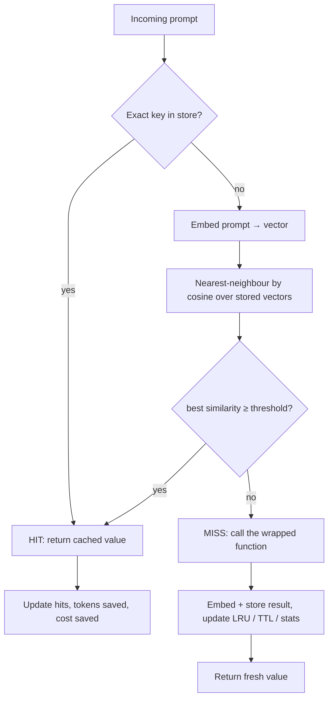

<div align="center">


# semcache

**Zero-infra semantic cache for LLM calls — cut duplicate spend with no proxy, no server, no account.**

_Built and maintained by **Viprasol Tech**._

[](https://github.com/Viprasol-Tech/semcache/actions/workflows/ci.yml)
[](LICENSE)
[](https://www.python.org/)
[](https://github.com/Viprasol-Tech/semcache)
[](https://t.me/viprasol_help)

</div>

---

`semcache` is a **semantic cache for LLM (or any expensive `text -> text`) calls**. Instead of caching only on an exact string match, it **embeds the prompt** and returns a cached result when a *semantically similar* prompt (cosine similarity ≥ threshold) was seen before. Wrap any callable with a decorator, get instant cache hits on paraphrases, and watch your duplicate token spend drop.

It is a **library, not a proxy**. There is no server to run, no gateway to route through, and no account to create. `semcache` ships a deterministic, offline `HashingEmbedder`, so the demo and the entire test suite run with **zero network access** — and you can swap in a real embedder (OpenAI, sentence-transformers) with a one-method protocol when you want production-grade semantics.

## Why exact-match caches miss

LLM apps see the *same question asked a hundred different ways*: "how do I reset my password", "how can I reset the password", "i forgot my password, help". A traditional key-value cache treats every variant as a brand-new key and pays for the model call every single time. `semcache` caches on **meaning**, so the second through hundredth paraphrase are free.

## Quickstart

```bash
git clone https://github.com/Viprasol-Tech/semcache.git
cd semcache
pip install -e .

semcache demo        # seed prompts, query paraphrases, show HIT/MISS + stats — offline
semcache stats       # the same workload, focused on tokens/$ saved
```

No network. No API keys. No account. The default `HashingEmbedder` is deterministic, so the demo and the test suite are reproducible everywhere.

## Sample output

`semcache demo` seeds three support prompts, then fires five queries — paraphrases hit, the unrelated one misses:

```text
semcache demo  (threshold=0.6, seeded 3 prompts, offline HashingEmbedder)

Querying paraphrases against the seeded cache:

  HIT   how can I reset my password?
  HIT   what is your refund policy please?
  HIT   how do I cancel my subscription?
  HIT   How do I reset my password?
  MISS  Tell me a joke about penguins.

╭──────────────────────────────────────╮
│ semcache — semantic cache report     │
╰──────────────────────────────────────╯
       semcache :: statistics
┏━━━━━━━━━━━━━━┳━━━━━━━━━━━━━━━━━┓
┃ Metric       ┃           Value ┃
┡━━━━━━━━━━━━━━╇━━━━━━━━━━━━━━━━━┩
│ Lookups      │               5 │
│ Hits         │               4 │
│ Misses       │               1 │
│ Hit rate     │           80.0% │
│ Entries      │               3 │
│ Evictions    │               0 │
│ Tokens saved │             675 │
│ Cost saved   │       $0.0042   │
└──────────────┴─────────────────┘
```

Four of five lookups served from cache — an **80% hit rate** on prompts an exact-match cache would have missed entirely.

## Features

- 🧠 **Semantic hits** — cosine similarity over embedded prompts, with a tunable `threshold` (default `0.9`).
- ⚡ **Exact-match fast path** — identical prompts skip the vector search entirely.
- 🪶 **Zero infrastructure** — a Python library, not a proxy or server; works fully offline.
- 🔌 **Pluggable embedders** — ship the deterministic `HashingEmbedder` or implement the `Embedder` protocol for OpenAI / sentence-transformers.
- 🎀 **One-line decorator** — `@semantic_cache(...)` wraps any `func(prompt) -> str`; the store hangs off `wrapped.cache`.
- ♻️ **LRU eviction + TTL** — bounded `max_size` and optional `ttl_seconds`, with an **injectable clock** for deterministic tests.
- 🏷️ **Namespaces** — isolate tenants / use-cases so their entries never cross-match.
- 💰 **Savings accounting** — tracks hit rate, tokens saved, and estimated `$` saved from a per-model price table.
- 📊 **Rich dashboard** — a colour terminal report of stats and recent entries.
- ✅ **Strict & typed** — `mypy --strict`, full type hints, and a large offline test suite.

## Python usage

Wrap a "real" LLM call. The function only runs on a cache miss; paraphrases return the cached answer for free:

```python
from semcache import semantic_cache

@semantic_cache(threshold=0.8, model="gpt-4o")
def ask_llm(prompt: str) -> str:
    # imagine this is an expensive OpenAI / Anthropic call
    return expensive_model_call(prompt)

ask_llm("How do I reset my password?")        # MISS -> calls the model, caches it
ask_llm("how can I reset the password?")      # HIT  -> served from cache, no model call
ask_llm("i forgot my password, help")         # HIT  -> same meaning, still free

print(ask_llm.cache.stats.hit_rate)           # 0.666...
print(ask_llm.cache.stats.tokens_saved)       # tokens you did not pay for
print(f"${ask_llm.cache.stats.cost_saved:.4f}")
```

Or drive the cache directly:

```python
from semcache import SemanticCache

cache = SemanticCache(threshold=0.8, max_size=10_000, ttl_seconds=3600)
cache.set("How do I reset my password?", "Open Settings > Security…", tokens=180, model="gpt-4o")

cache.get("how can I reset the password?")    # 'Open Settings > Security…'
hit, value, similarity = cache.lookup("forgot password help")  # inspect without mutating stats
```

## How it works



## CLI reference

| Command | What it does |
| --- | --- |
| `semcache demo` | Seed a few prompts, query paraphrases to show HIT vs MISS, print the stats table (`--threshold`). |
| `semcache stats` | Run the demo workload and report tokens / `$` saved (`--threshold`). |
| `semcache version` | Print the installed version. |

## Plug in a real embedder

The `HashingEmbedder` is great for tests and offline demos. In production, implement the tiny `Embedder` protocol with any real embedding model — nothing else changes:

```python
from openai import OpenAI
from semcache import SemanticCache

class OpenAIEmbedder:
    def __init__(self, model: str = "text-embedding-3-small") -> None:
        self._client = OpenAI()
        self._model = model

    def embed(self, text: str) -> list[float]:
        resp = self._client.embeddings.create(model=self._model, input=text)
        return resp.data[0].embedding

cache = SemanticCache(threshold=0.92, embedder=OpenAIEmbedder())
```

```python
# Or fully local with sentence-transformers:
from sentence_transformers import SentenceTransformer
from semcache import SemanticCache

class SBERTEmbedder:
    def __init__(self) -> None:
        self._model = SentenceTransformer("all-MiniLM-L6-v2")

    def embed(self, text: str) -> list[float]:
        return self._model.encode(text).tolist()

cache = SemanticCache(threshold=0.85, embedder=SBERTEmbedder())
```

Real embedders capture true paraphrase semantics (synonyms, restructured sentences), so you can usually raise the `threshold` for tighter, higher-precision hits.

## Roadmap

- [x] Offline deterministic `HashingEmbedder` + cosine nearest-neighbour
- [x] Exact-match fast path, LRU eviction, TTL with injectable clock, namespaces
- [x] `@semantic_cache` decorator with shared stores and savings accounting
- [x] Rich stats dashboard + CLI demo
- [ ] Persistent backends (SQLite / Redis vector store)
- [ ] Approximate nearest-neighbour index for large caches
- [ ] First-class OpenAI / sentence-transformers embedder extras
- [ ] Async decorator + streaming-aware caching

## FAQ

**Does it call an LLM or embedding API?** No. The default `HashingEmbedder` is fully offline and deterministic, so the demo and every test run with zero network access. You opt into a real embedder explicitly.

**How is a "hit" decided?** The prompt is embedded and compared by cosine similarity to every stored vector; the nearest neighbour wins if its similarity clears the `threshold`. Identical prompts take an exact-match fast path.

**Will it return a wrong answer for a different question?** Only if your `threshold` is too low for your embedder. Tune it: the `HashingEmbedder` works well around `0.6–0.8`; high-quality semantic embedders can run tighter (`0.85–0.95`).

**Is it thread-safe / production-ready?** It is a clean, strictly-typed in-process cache. For multi-process or persistent setups, back it with the upcoming SQLite/Redis stores (roadmap) or share one process-wide instance.

**How are the savings computed?** Each stored entry carries a `tokens` count and optional `model`; on every hit `semcache` adds those tokens (and their blended per-model `$` cost) to the running `Stats`.

---

### ⭐ Star semcache if it cut your LLM bill

> **Disclaimer:** `semcache` is provided **as-is** for engineering use. A semantic cache can return a previously-stored answer for a *similar-but-not-identical* prompt; choose a `threshold` and embedder appropriate to your correctness requirements, and do not cache responses that must be unique per request.

## Contact — Viprasol Tech Private Limited
- Website: [viprasol.com](https://viprasol.com)
- Email: [support@viprasol.com](mailto:support@viprasol.com)
- Telegram: [t.me/viprasol_help](https://t.me/viprasol_help) | WhatsApp: +91 96336 52112
- GitHub: [@Viprasol-Tech](https://github.com/Viprasol-Tech) | [LinkedIn](https://www.linkedin.com/in/viprasol/) | X [@viprasol](https://twitter.com/viprasol)

## License

[MIT](LICENSE) (c) 2025 Viprasol Tech Private Limited
